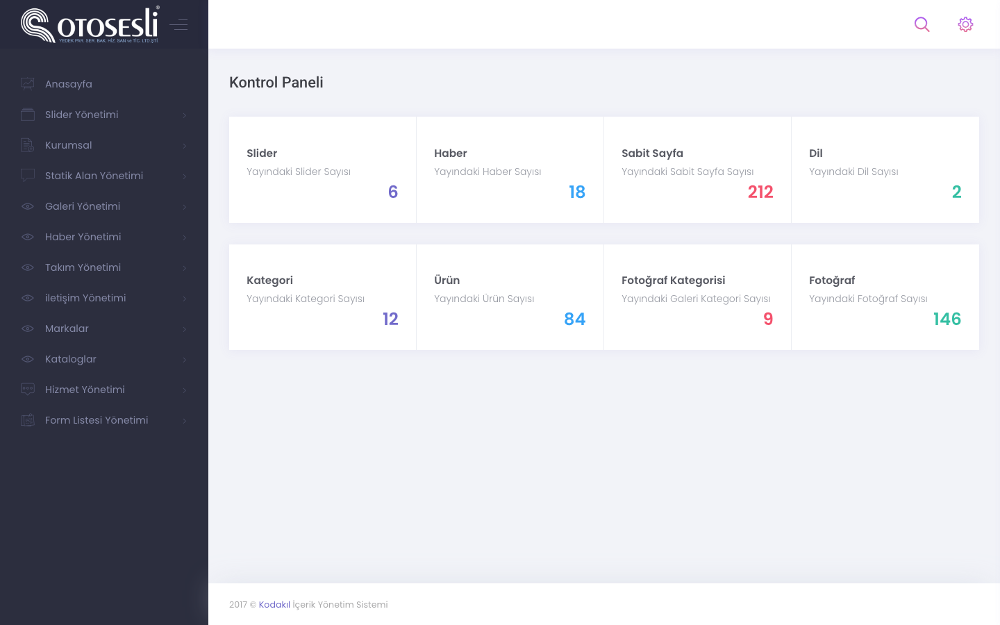
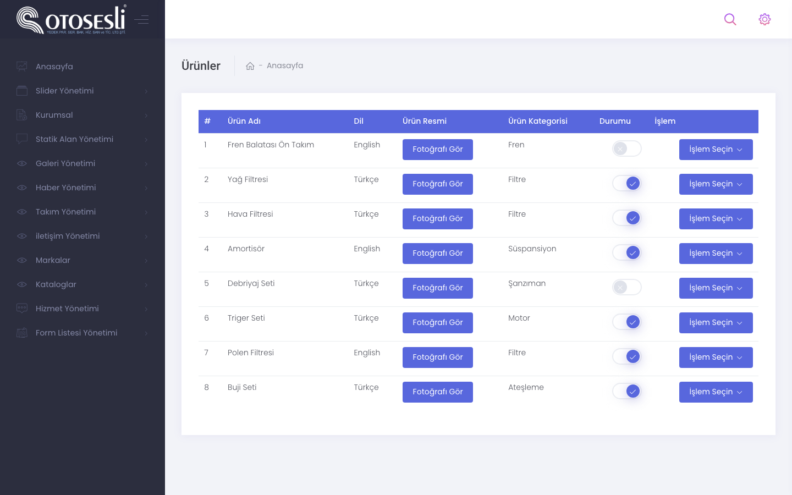
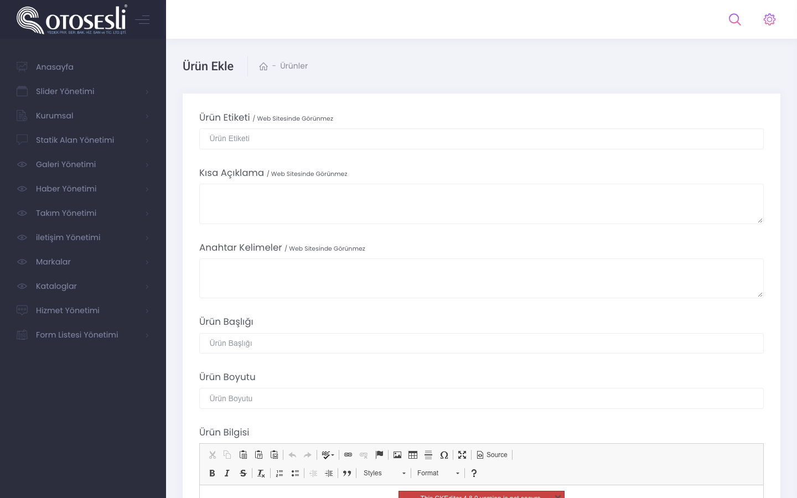
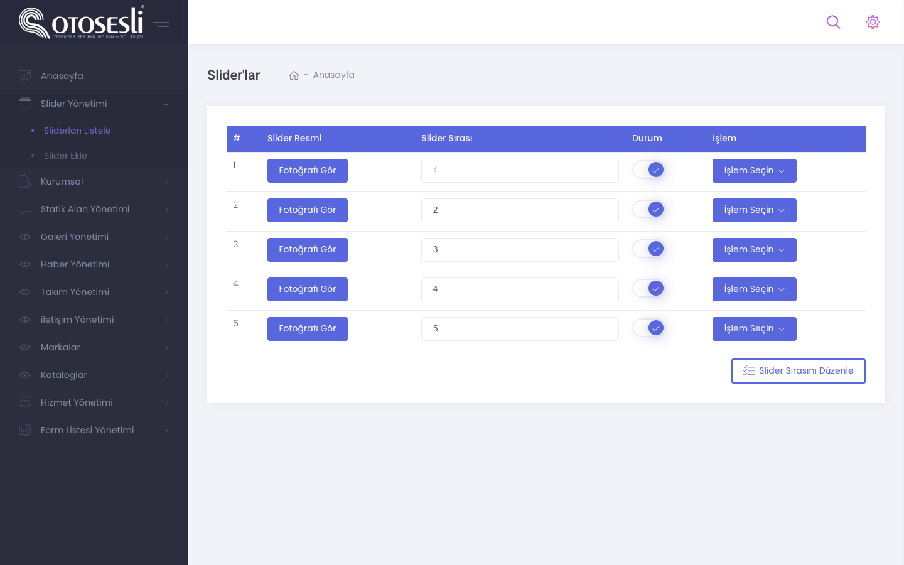
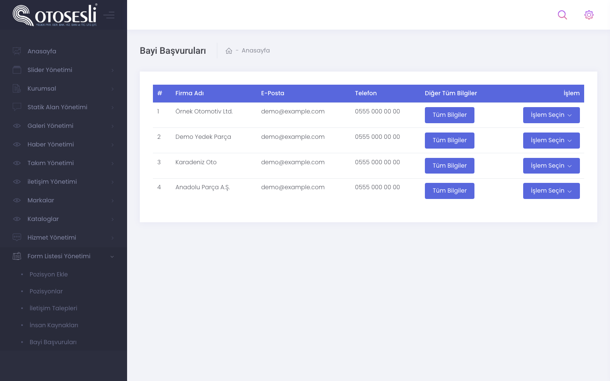
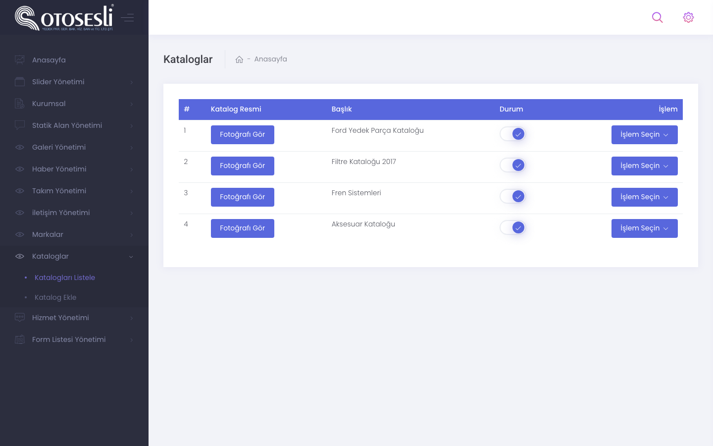
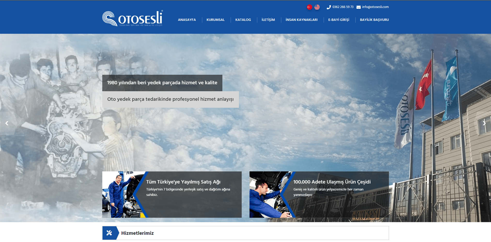
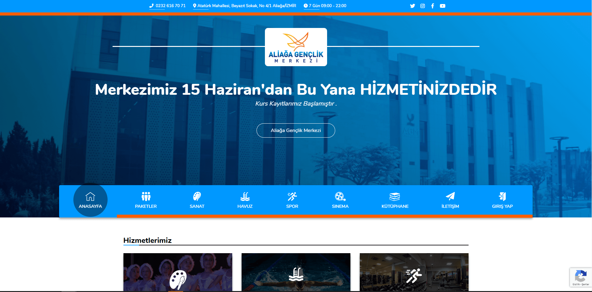
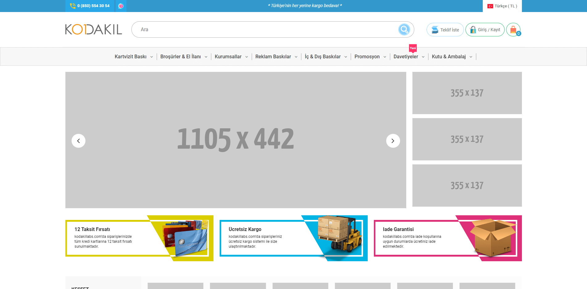

# Kodakil CMS — Multilingual Content Management for Agency Sites

**The in-house CMS we built at KODAKIL**, the software agency I co-founded, and reused across our corporate and e-commerce client sites. This repository is the reference install that ran the **Oto Sesli** corporate website: 30 admin modules for content, catalogues, forms and translations on CodeIgniter 3.




| | |
|---|---|
| **Role** | Co-founder and lead front-end developer: admin UI, module patterns and site front ends |
| **Period** | 2017 |
| **Scale** | 30 admin modules · 38 controllers · 39 models · 116 views |
| **Used by** | Oto Sesli, ARG Grup, Aliağa Youth Centre, E-basım, Kontrol Deposu, MakingKnowing, kodakil.com and more |
| **Stack** | PHP · CodeIgniter 3.1.7 · MySQL · Metronic admin · jQuery · Summernote · Dropzone · Toastr · PHPMailer |

## One codebase, many sites

Agency projects kept needing the same building blocks: sliders, menus, news, galleries, team and references, forms that land in an inbox and a panel, and **two or more languages**. The CMS kept them in one CodeIgniter codebase with a consistent module pattern, and each client site switched on the modules it needed.

## Module pattern

Every module is a controller under `controllers/Admin/`, a model under `models/Admin/` and a set of `views/Admin/` screens following the same verbs:

| Verb | What it does |
|---|---|
| `index` | list with status toggles and a manual sort order (`sort` column) |
| `add` / `edit*` | form with per-language fields and Summernote rich text |
| `*StatusUpdate` / `editStatus` | publish / unpublish inline |
| `ImageUpload` / `*ImageUpload` | Dropzone uploads, thumbnails through `thumb.php` |
| `delete*` | confirm, then delete |

## Modules

| Area | Modules |
|---|---|
| **Content** | static pages, corporate, services, news (with photo galleries), blog, projects, references, team, certificates, testimonials, FAQ |
| **Media** | sliders (desktop and separate mobile sliders), photo gallery with categories and sorting, video gallery with categories |
| **Catalogue** | product categories, products and "new products", trademarks, **PDF catalogues** |
| **Forms & leads** | contact form, call-back requests, **dealership applications**, **job applications** with positions, Excel export |
| **Academy** | programs with days, day details, instructors and registrations |
| **Site** | menus, SEO meta, **languages and translated static strings**, admin login with reCAPTCHA |

## Screens

| | |
|---|---|
|  **Products:** language, category, status toggle, actions |  **Product editor:** label, SEO description, keywords, rich text |
|  **Sliders** with sort order |  **Dealer applications** from the public form |

<p align="center"></p>

<sub>Admin screens are rendered from the real views with fictional data (`tools/admin-preview`).</sub>

## Sites built on it

| | |
|---|---|
|  **Oto Sesli:** automotive parts distributor, corporate site with catalogues and dealer applications |  **ARG Grup:** industrial automation and robotics |
|  **Aliağa Youth Centre:** courses, teachers, events |  **E-basım:** print-shop e-commerce |

## Repository layout

```
application/
├── controllers/   public pages + Admin/ (30 modules)
├── models/        Admin/ models and public models
├── views/         public views + Admin/ (94 admin screens)
├── libraries/     Mailler (PHPMailer)
└── config/        credentials read from environment variables
helpers/kodakil_helper.php   admin_url(), formatting and upload helpers
assets/Front/                public site CSS, JS and images
theme/                       admin theme: Metronic (commercial, not included) + our custom.css
system/                      CodeIgniter 3.1.7
tools/admin-preview/         renders the admin views with demo data
```

```bash
# with a licensed Metronic copy in ./theme
php -d short_open_tag=On -S localhost:8086 tools/admin-preview/router.php
```

## What I would do differently today

- **Hash admin passwords** and move login into an auth library with rate limiting.
- Replace per-module copy-paste with a **base CRUD controller** and form schema per module.
- Keep translations in **files under version control** rather than only in the database.
- A headless setup (API + typed front end) so the same content could feed apps and static builds.

---

<sub>Built at KODAKIL. Credentials and personal contact details have been removed; uploaded media and the commercial Metronic theme are not included. Shared for portfolio purposes; no license is granted for reuse.</sub>
